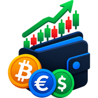

[🇪🇸 Español](README-ESP.md) | [🇬🇧 English](../README.md)

<p align="center">
  
</p>

<h1 align="center">PorfolioManager</h1>

<p align="center">
  <a href="../CHANGELOG.md"></a>
  <a href="https://github.com/FranciscoFdez05/PorfolioManager/actions/workflows/ci.yml"></a>
  
  
  <a href="../LICENSE"></a>
</p>

---

Aplicación web **autoalojada** para el seguimiento de una cartera de inversión personal. Todo se guarda en SQLite y corre en tu máquina o en un servidor doméstico con Docker.

Las cotizaciones externas son opcionales: sin claves de API, los precios los introduces tú. La interfaz está en español.

## ✨ Características ✨

- **Cartera**: resumen, ficha por activo con precio medio, rendimiento y desglose entre efecto activo y efecto divisa, y planes de inversión.
- **Finanzas**: gastos, ingresos, ingresos recurrentes con pagas extra, mensualidades, cuentas de dinero, dividendos, renta fija y bonos.
- **Fiscalidad española**: ventas con FIFO, regla de los dos meses y compensación de pérdidas; informe anual en CSV y HTML.
- **Métricas**: TWR, XIRR, drawdown, volatilidad y comparación con índices.
- **Cripto**: stablecoins, operaciones, conversiones, staking y earn. Enlace de wallets en solo lectura (Bitcoin por dirección —Legacy, SegWit o Taproot—, xpub/ypub/zpub —también de cuentas Taproot— o clave pública suelta, con detección automática del formato; Ethereum y BNB Smart Chain por dirección o clave pública; Solana y XRP) que importa los movimientos on-chain a Transacciones, y un apartado **Seguimiento** con el saldo, el valor en euros y los últimos movimientos de tus wallets y de las ajenas que sigas, con avisos opcionales por Telegram de cada movimiento nuevo; las direcciones y xpub se guardan cifradas y nunca se muestran enteras.
- **Alertas**: alertas de precio por activo y avisos de caídas y subidas bruscas, rentabilidad de la posición, precio frente al precio medio, activos sin cotización, valor y caída de la cartera y peso de un activo (sobre un activo o sobre toda la cartera) por Telegram, vigiladas por el servidor aunque la web esté cerrada.
- **Operación**: backups automáticos, avisos y comandos por Telegram, verificación en dos pasos opcional con código por Telegram, HTTPS desde la propia aplicación y Atajo de iOS para apuntar gastos desde el móvil.
- **Actualización segura**: `docker-update.sh` comprueba que la versión nueva responde en `/api/health` y vuelve a la imagen anterior si no lo hace.

## 🖥️ Requisitos

| Para | Necesitas |
|---|---|
| **Usarlo** | Docker con Compose v2 (recomendado un servidor Linux), o Python 3.11+ sin Docker |
| **Desarrollar** | Python 3.11+ (la CI prueba 3.11, 3.12 y 3.13) y Node.js 20 para el linter y los tests del frontend |

## 📦 Guía de instalación ⚙️

### Opción 1: Docker (recomendada)

```bash
git clone https://github.com/FranciscoFdez05/PorfolioManager.git
cd PorfolioManager
./docker-setup   # crea .env, genera SECRET_KEY, pide credenciales y puerto, levanta el stack
```

El stack levanta la web, un servicio **worker** con la misma imagen para las tareas de fondo (copias automáticas, snapshots, Telegram y avisos de precios, wallets y monedas de Satoshi, para que nunca ocupen los hilos de gunicorn), el proxy Caddy y el vigilante de actualizaciones. Ejecútalo con tu usuario normal, sin `sudo`. La aplicación queda en `http://localhost:5080` (o `http://<IP_DEL_SERVIDOR>:5080` desde otro equipo de la red local). Los datos se guardan en `data/`, `logs/` y `API/`.

> [!WARNING]
> De serie la aplicación se sirve por HTTP plano, así que la contraseña y la cookie de sesión viajan sin cifrar. Antes de usarla desde otro dispositivo, activa HTTPS en **Ajustes › Seguridad › HTTPS**. Consulta [SECURITY.md](../SECURITY.md).

Para actualizar una instalación existente:

```bash
./docker-update.sh              # git pull, build, arranque y comprobación, con vuelta atrás automática
./docker-update.sh --sin-pull   # igual, sin git pull
```

### Opción 2: desde el código fuente

```bash
git clone https://github.com/FranciscoFdez05/PorfolioManager.git
cd PorfolioManager
python -m venv .venv && source .venv/bin/activate   # Windows: .venv\Scripts\activate
pip install -r requirements.txt
python python/server.py   # http://localhost:5080
```

### Variables de entorno

Los secretos van en `.env` (copia `.env.example`; `./docker-setup` lo hace por ti). El resto de ajustes están en `config.ini`.

| Variable | Descripción | Obligatoria | Por defecto |
|---|---|---|---|
| `SECRET_KEY` | Firma las sesiones y cifra en reposo las claves de API y las credenciales | Sí | La genera `docker-setup` |
| `LOGIN_USERNAME` | Usuario inicial, solo se usa en el primer arranque | Sí | `admin` |
| `LOGIN_PASSWORD_HASH` | Hash de la contraseña inicial (lo genera `docker-setup`) | Sí | vacío |
| `FINNHUB_API_KEY`, `EODHD_API_KEYS`, `ALPHA_VANTAGE_API_KEYS` | Claves de datos de mercado; lo normal es ponerlas en Ajustes › API | No | vacío |
| `ETHERSCAN_API_KEY` | Clave de Etherscan v2 para leer wallets de Ethereum (BNB solo con un plan de pago de Etherscan); también se puede guardar desde la pantalla de wallets, desde **Editar** en un seguimiento o en **Ajustes › API** (es una sola: guardar otra la sustituye) | No | vacío |
| `NODEREAL_API_KEY` | Clave de NodeReal, alternativa con plan gratuito para leer wallets de BNB Smart Chain; la API de BNB se elige en **Ajustes › API › Estado de las APIs**. También se puede guardar en **Ajustes › API** (es una sola: guardar otra la sustituye) | No | vacío |
| `TZ` | Zona horaria del contenedor (logs y backups) | No | `Europe/Madrid` |
| `PORT` | Puerto HTTP; sobrescribe `config.ini` | No | `5080` |
| `PUID` / `PGID` | Usuario y grupo con los que escribe el contenedor (Linux) | No | Los fija `docker-setup` |

## 📋 Guía de uso 🕹️

1. Ejecuta `docker-setup` y elige cómo crear la cuenta: **1** web (te da la dirección de `/setup` y un código de un solo uso), **2** terminal, **3** cerrar.
2. Abre `http://localhost:5080` e inicia sesión.
3. Añade tus activos y operaciones. Sin claves de API, los precios se introducen a mano.
4. Opcional, en **Ajustes**:
   - **API**: claves de Finnhub, EODHD o Alpha Vantage para cotizaciones automáticas.
   - **Seguridad › HTTPS**: si entras desde otros dispositivos.
   - **Telegram**: avisos y comandos (`/estado`, `/cartera`, `/backup`).
   - **Cuenta**: verificación en dos pasos con código por Telegram y frase de recuperación.
   - **Módulos**: qué módulos salen en el menú y cuál se abre al iniciar.
   - **Apariencia › Idioma**: idioma de la interfaz, español o inglés. Es independiente de los formatos de número y fecha de la misma página. La traducción está en curso: el menú, la cabecera, el panel lateral y esta página de ajustes ya están; el resto de pantallas sigue en español.

| Dónde | Qué haces ahí |
| --- | --- |
| Ficha de un activo › **Gráfico** | Precio o rendimiento de tu posición, con tus compras y ventas marcadas |
| Ficha de un activo › **Mercado** | Capitalización, suministro, FDV y volumen; futuros (interés abierto, financiación) en cripto; tendencia y fundamentales en el resto |
| **Mi dinero › Cuentas / Movimientos / Cuenta remunerada** | Saldo e histórico de cada cuenta, transferencias e intereses cobrados |
| **Mi dinero › Hipotecas / Compras financiadas** | Cuadro de amortización y métricas de cada hipoteca (fija o variable con revisiones de Euríbor y amortizaciones anticipadas) y tus compras a plazos (se cobran cada mes como mensualidades etiquetadas desde la cuenta que elijas, con pagos anticipados y calendario de cuotas) |
| **Mi dinero › Patrimonio** | Patrimonio neto: inversiones, cuentas y renta fija sin vencer menos hipotecas, compras financiadas y microcréditos, con el desglose de cada lado |
| **Mi dinero › Hipotecas › Simular amortización** | Compara una hipoteca con un pago anticipado hipotético, acortando el plazo o bajando la cuota, sin guardar nada |
| **Mi dinero › Calendario › Vencimientos** | Vencimientos de tu renta fija y bonos en el calendario, junto a gastos, ingresos y pagos recurrentes |
| **Dividendos › Ingresos pasivos** | Dividendos de los últimos 12 meses, media mensual y rentabilidad sobre coste por activo y global |
| **Dividendos › Reinvertir** | Un dividendo se puede marcar como reinvertido: añade a la ficha del activo una compra «Reinvertido» que cuenta en la posición y en el FIFO |
| **Ajustes › Exportar a CSV** | Descarga gastos, ingresos, dividendos, operaciones y cuentas en CSV listo para Excel |
| **Herramientas › Proyección** | Interés compuesto, independencia financiera (cuánto necesitas y cuándo llegas), cuánto dura un capital retirando cada año, Monte Carlo con la volatilidad de tu cartera y rentabilidad real tras impuestos e inflación |
| **Herramientas › Cartera / Mercado** | Simular una compra (unidades que salen por lo invertido, precio medio nuevo, posición y peso en la cartera, en automático desde tus posiciones o todo a mano), tamaño de posición por riesgo, cuánto hay que subir para recuperar una caída, DCA frente a invertir todo de golpe con precios históricos reales, el ratio entre dos activos cualesquiera frente a su historia, un comparador que solapa en un gráfico de dos a ocho activos (de tu cartera o buscados por ticker con cualquiera de las APIs) con su rentabilidad, volatilidad, caída máxima y correlación, y una tabla de equivalencias: escribes una cantidad de cualquier divisa, acción, ETF, cripto o metal y ves cuánto vale en todos los demás, con el rendimiento de cada uno en un gráfico |
| **Herramientas › Fiscal** | Simular una venta, ver qué posiciones en pérdidas vender para rebajar el IRPF del año (y cuándo recomprar), prever la cuota del ahorro con ventas, dividendos e intereses, y calcular la doble imposición de un dividendo extranjero |
| **Herramientas › Propias** | Crear tus propias calculadoras desde la página, sin código: campos de entrada y resultados calculados con fórmulas como `gastoAnual / (tasa / 100)`. Comunes a todos los portfolios y dentro de las copias de seguridad |
| **Mi dinero › Microcréditos** | Préstamos pequeños y de corta duración, con pago único (importe más comisión) o en cuotas mensuales: coste, TAE equivalente, vencimientos con aviso de los vencidos y calendario en los de cuotas |
| **Cripto › Transacciones › ··· › Wallets enlazadas** | Importar los movimientos de tus wallets desde la blockchain (nunca pegues claves privadas ni frases semilla) |
| **Cripto › Seguimiento** | Agrupar wallets propias o ajenas, ver su historial, UTXOs y tokens, y recibir avisos por Telegram |

El detalle de cada pantalla está en la [guía de uso completa](guia-de-uso.md).

```bash
docker logs -f PorfolioManager   # ver los logs en tiempo real
docker logs -f PorfolioManager-worker   # tareas de fondo
docker compose down              # parar el stack
```

Documentación adicional:

- [Guía de uso](guia-de-uso.md): cada pantalla paso a paso (wallets, tokens, avisos, Mi dinero, gráficos).
- [DOCUMENTACION.md](../DOCUMENTACION.md): guía completa (configuración, claves API, backups, HTTPS, Telegram, fiscalidad, desarrollo).
- [CHANGELOG.md](../CHANGELOG.md), [SECURITY.md](../SECURITY.md), [CONTRIBUTING.md](../CONTRIBUTING.md)
- [Atajo de iOS](atajo-ios.md) y [herramientas propias](herramientas-extra.md)
- [Vigilante de actualización](../tools/actualizador/README.md) para actualizar desde Ajustes

## 🤝 Contribuciones 🤝

1. Haz un fork del repositorio.
2. Crea una rama: `git checkout -b feature/nueva-funcionalidad`.
3. Comprueba que `pytest -m "not network"`, `ruff check .` y `npm test` pasan correctamente.
4. Haz commit y abre un Pull Request.

## 📜 Licencia

📄 Este proyecto está licenciado bajo la Licencia GPL-3.0. Consulta el archivo [`LICENSE`](../LICENSE) para más detalles.

---

<p align="center">
  Desarrollado con ❤️ por <a href="https://github.com/FranciscoFdez05">Francisco</a>
</p>
